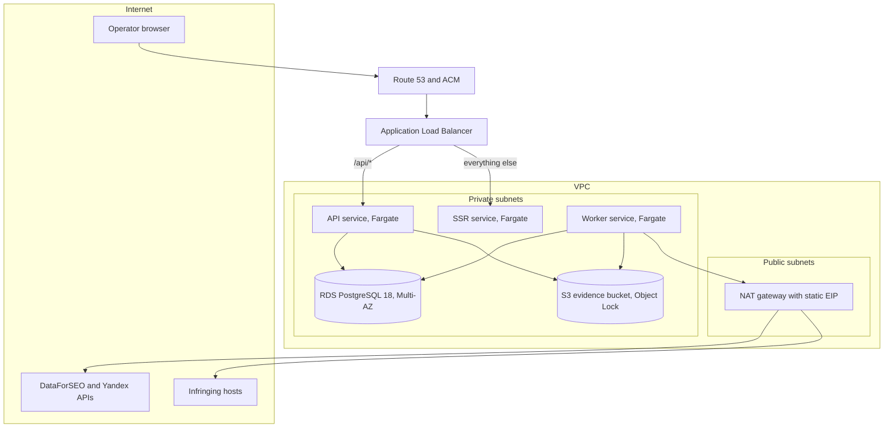

# Deployment platform and environment topology

Patrol deploys to **AWS in one region, `eu-central-1`**: three ECS Fargate services (the Fastify API, the worker, and the TanStack Start SSR app) behind one Application Load Balancer, RDS for PostgreSQL 18, S3 with Object Lock for evidence, and Secrets Manager for credentials. There are three environments — local, staging, and production — with forward-only migrations run as a one-off task before each deployment, split database and object backups, and datacenter egress. This document fixes the platform, the providers, the environment set, migration and backup procedure, egress, and secret storage; the stack is "_docs/adr/0005-single-postgres-for-jobs.md_" through "_docs/adr/0007-separate-api-and-contract-package.md_", the bucket requirements are "_docs/design/evidence-capture.md_", and the terms are those of "_GLOSSARY.md_".

## Platform and providers

| Concern | Choice | Why it beats the alternatives |
| --- | --- | --- |
| Compute | ECS Fargate, one service per deployable | Managed containers without servers; a PaaS such as Fly.io is cheaper to start, but the evidence bucket needs S3 Object Lock and the database needs managed PostgreSQL 18, so one vendor with native integration beats three |
| Load balancing | One ALB, `/api/*` to the API and everything else to the SSR app | Two deployables behind one hostname and one certificate, with health checks per service |
| Database | RDS for PostgreSQL 18, Multi-AZ in production, single-AZ in staging | Managed backups, point-in-time recovery, and failover; pg-boss and Drizzle need nothing a plain PostgreSQL lacks |
| Evidence storage | S3 with versioning and Object Lock in compliance mode | Storage-enforced immutability, which the evidence design requires and cheaper S3-compatible providers only imitate with policy |
| Credentials | Secrets Manager, read by the task role | Rotation and audit without secrets in images, task definitions, or the repository |
| Registry and logs | ECR and CloudWatch | The same account and IAM boundary as everything else |
| DNS and TLS | Route 53 and ACM | A certificate that renews without an operator |

The region is `eu-central-1` because the rights holder and its operators are in Europe, the provider APIs are global, and evidence fetches are not geo-restricted in v1. A second region is not part of the design: the service is single-tenant and small, and a regional failure is an outage, not a data loss, because backups are copied within the region and can be restored into a new stack.

The platform decision is "_docs/adr/0027-aws-fargate-rds-and-s3.md_".

## Topology

The API and SSR services sit behind the ALB and are reachable only through it. The worker has no inbound route: it runs pg-boss jobs, evidence captures, and scheduled drafts. RDS and the bucket are in private subnets or private endpoints; no service is reachable from the internet except through the ALB.

The three services share one image with different entrypoints, so a contract change ships to all of them from one build. Health checks are `/health` for the API and SSR and a queue-heartbeat check for the worker; a task that fails two consecutive checks is replaced.

## Environments

| | Local | Staging | Production |
| --- | --- | --- | --- |
| Compute | Docker Compose on the developer's host | One ECS task per service, single AZ | ECS tasks per service across two AZs, with autoscaling minimum one |
| Database | PostgreSQL 18 container | RDS PostgreSQL 18, single-AZ, small instance | RDS PostgreSQL 18, Multi-AZ |
| Object storage | MinIO, no Object Lock | S3 with versioning, Object Lock in governance mode | S3 with versioning, Object Lock in compliance mode |
| Recipients | Synthetic profiles; no real submission | Real profiles, delivery disabled by an administrator | Live profiles |
| Acquisition budget | Provider sandbox or none | A $5 monthly cap on a separate provider account | The $60 cap from "_docs/design/budget-envelope.md_" |
| Access | Localhost | Operators only, behind the same sign-in | Operators only |
| Seed data | A small fixture catalogue | A synthetic catalogue of about 20 titles | The rights holder's real catalogue |

Local development runs PostgreSQL, MinIO, the API, the worker, and migrated schema under Compose; the host needs Docker plus Node for the UI and TypeSpec toolchains, as the map's notes require. Staging is production with the dangerous parts switched off: real recipient profiles exist so field rendering is exercised, but a profile cannot be handed off until an administrator enables delivery, and acquisition runs against a small cap on a separate provider account so tests cannot touch the production balance.

## Migration procedure

Migrations are Drizzle SQL files, numbered and committed, and applied by a one-off ECS task built from the same image. The decision is "_docs/adr/0028-migrations-are-forward-only.md_". The deployment order is fixed:

1. Take an RDS snapshot and record its identifier in the deployment log.
2. Run the `migrate` task on a network path to the database.
3. Roll the API service, then the worker, then the SSR service.
4. Wait for the worker to drain before replacing its tasks, so no scan or capture is killed mid-flight.

The API and worker refuse to start when their expected schema version is ahead of the database or behind it by a migration the image does not carry, which turns a partial deploy into a failed, visible deploy rather than a subtly wrong one. Migrations are **forward-only**: there is no down migration. A destructive change — a dropped column, a rewritten table — is split across two releases, expand then contract, and a long lock is avoided with `CREATE INDEX CONCURRENTLY` and batched backfills.

The `migrate` task runs once per deployment, not once per task, and each migration takes an advisory lock so two deployments cannot apply the same file.

## Backup and restore

| Material | Backup | Retention | Restore |
| --- | --- | --- | --- |
| PostgreSQL data | RDS automated backups with point-in-time recovery to the second | 14 days | Restore to a new instance, then repoint the services |
| PostgreSQL logical dump | Nightly `pg_dump` to a versioned bucket in the same region | 35 days | `pg_restore` into a fresh instance for a partial recovery |
| Evidence and derived objects | S3 versioning, with Object Lock on evidence | Per the evidence retention windows | Objects are versioned and content-addressed; a restore is a copy, never an overwrite |
| Configuration | Infrastructure defined in code, in the repository | Repository history | Rebuild the stack from code and the last database restore |

Recovery targets are a **five-minute RPO** for the database, set by point-in-time recovery, and a **four-hour RTO** for the whole stack, dominated by restoring the database into a new instance and rolling the services. A restore drill runs quarterly into a scratch stack: restore the latest snapshot and dump, run the migrations, boot the API against it, and fetch one evidence object. A backup that has not been restored is not a backup.

The bucket's Object Lock is the reason the object path has no backup of its own: compliance mode prevents deletion before the retention date, and versioning prevents an overwrite from losing a version. A bucket-level replication rule to a second bucket in the same region is added in production for the case of accidental policy deletion, not for regional failure.

## Egress

All outbound traffic leaves through the NAT gateway with a static Elastic IP, from datacenter addresses, and identifies itself as Patrol:

- **Search acquisition** is HTTPS to DataForSEO and Yandex Cloud, so the egress IP is listed in each provider's allowlist where the vendor supports one.
- **Evidence capture** fetches infringing pages from that same egress, presenting the user agent "_docs/adr/0018-single-url-evidence-fetch.md_" fixes. The design does not rotate proxies, exit nodes, or user agents.
- **Submission** never leaves the network: no code path contacts a recipient's form, per "_docs/adr/0014-operator-performed-submission.md_", so there is no browser automation egress to design for in v1.
- **SMTP**, **the provider balance probes**, and **CloudWatch** share the same path.

No residential proxy is bought or configured. A host that blocks the datacenter range is recorded as `blocked` and surfaced, which is the same posture the capture design takes on challenges. A per-territory egress route is revisited only if real captures show geo-blocking that a territory-specific exit fixes.

## Secrets

Secrets live in Secrets Manager and are injected at task start, never baked into an image or committed:

| Secret | Consumer |
| --- | --- |
| RDS master credentials | RDS rotation plus the API and worker tasks |
| DataForSEO API key | The worker's Google adapter |
| Yandex Search API key and folder id | The worker's Yandex adapter |
| SMTP credentials | The API and worker, for invitations, resets, and alerts |
| Session and CSRF signing material | The API, rotated on a schedule that invalidates sessions deliberately |

Each task role can read only the secrets it needs and only the bucket prefixes it writes: the worker writes evidence and raw payloads, the API reads evidence and writes nothing to the bucket except handoff packs. An operator never sees a provider key in the UI; the settings screen shows only which key is configured and when it was last verified.

## Cost

At the design point the infrastructure is roughly **$150 to $200 per month**: three Fargate tasks, a small Multi-AZ RDS instance, the ALB, the NAT gateway, S3 storage and requests, Secrets Manager, and CloudWatch. The acquisition cap of $60 is separate. The estimate is an order of magnitude for the rights holder's decision, not a quote: the first month's bill replaces it.

## What this implies for the model

Nothing in the domain model changes; deployment is configuration and infrastructure. The HTTP contract exposes a `/health` endpoint and a read-only build and migration-version report, which the load balancer and the deployment pipeline consume. The infrastructure itself is code in a separate repository, and its first commit belongs to the build effort, not to this map.

## Open risks

- One region and one NAT gateway are availability compromises: a regional outage or a NAT failure takes the service down, and the recovery is a restore, not a failover.
- Object Lock in compliance mode is irreversible, so a retention date written at capture can never be shortened; a wrong date is permanent storage cost.
- The `$150` to `$200` estimate is a guess until billed, and Fargate and NAT costs move with traffic volume.
- A four-hour RTO depends on a restore that has been rehearsed; skipping the quarterly drill quietly turns the target into an aspiration.
- The static datacenter egress will be blocked by some hosts that would serve a residential address, and the design accepts losing those captures rather than rotating exits.
- A single deployment applies migrations to one database; adding a second region would need a migration strategy this design does not include.

## Sources

- AWS documentation for ECS Fargate, Application Load Balancer, RDS for PostgreSQL 18, S3 Object Lock in compliance mode, Secrets Manager, and CloudWatch (accessed 2026-11-03).
- "_docs/adr/0005-single-postgres-for-jobs.md_" through "_docs/adr/0007-separate-api-and-contract-package.md_" for the worker, pg-boss, the bucket, and the separate API.
- "_docs/design/evidence-capture.md_" and "_docs/adr/0016-evidence-is-a-rendered-page-bundle.md_" through "_docs/adr/0018-single-url-evidence-fetch.md_" for Object Lock and capture posture.
- "_docs/design/budget-envelope.md_" for the acquisition cap that the hosting budget sits beside.
