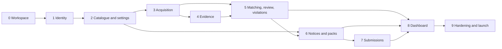

# Build slices

Each slice is sized for one or a few build tickets, ends in something demonstrable, and names what it de-risks. Dependencies are real, not stylistic: a slice may start only when its listed predecessors are merged. Every slice includes the API operations and the screens for its scope; the contract is not built ahead of its consumers.

## Dependency graph

## Slice 0 — Workspace, contract pipeline, and runtime skeleton

**Depends on:** nothing.

**Deliverables**

- A pnpm workspace with `apps/api`, `apps/worker`, `apps/web`, and the contract package, with the TypeSpec package and its generated artifacts carried over from "_contract/_".
- CI that compiles the contract, runs `npm run check`, runs `npm run verify`, typechecks, tests, and fails when a generated artifact is stale.
- Docker Compose with PostgreSQL 18, MinIO, the API, the worker, and the SSR app, each with a health check.
- A Fastify 5 skeleton with the Ajv 2020 validator over the emitted bundle, the shared error handler that emits `ErrorBody`, request-id logging, and `/health`, `/system/version`, `/system/setup`.
- The Drizzle migration harness with numbered forward-only SQL and a migration check on startup.
- A TanStack Start shell that uses the generated client against `/api`, with one loader-backed page proving the round trip.
- Bilingual string catalogues with a key-parity test and English as the fixed test locale.

**Acceptance**

- `docker compose up` serves `/health` with `200` and the SSR page renders.
- A generated client call reaches a stub route, and an invalid body answers `400` with `fieldErrors`.
- A fresh database migrates from zero, and the API refuses to start against a schema it does not expect.
- CI fails when a TypeSpec model changes without regenerating the committed artifacts, or when a Russian catalogue key is missing.

**De-risks:** contract drift, local-to-cloud parity, generator and validator wiring, migration ordering.

## Slice 1 — Identity, bootstrap, sessions, and roles

**Depends on:** 0.

**Deliverables**

- Tables and migrations for the rights holder, operators, invitations, sessions, recovery codes, and TOTP enrolment.
- `patrol bootstrap` with a one-time setup token, idempotent and refusing once a rights holder exists; `patrol admin recover` for the last administrator.
- Password hashing, TOTP enrolment and verification, recovery codes, the sign-in challenge, session rows, rotation, idle and absolute expiry.
- The CSRF middleware and role guard driven by the contract's `x-patrol-roles` and the session.
- The authentication, session, operator, and invitation operations from "_contract/HTTP.md_", including the operator's stored interface language and its effect on API messages and emails.
- Write-only security events for sign-in, invitation, credential change, session revocation, lockout, and recovery-code use.

**Acceptance**

- The setup-token flow ends with a signed-in administrator holding recovery codes; a second bootstrap attempt is refused.
- A wrong password, a wrong code, a locked account, and a used recovery code each answer the declared error code.
- A mutation without `X-Patrol-CSRF` is refused; a mutation outside the caller's role answers `403`.
- Password, role, email, and TOTP changes revoke the sessions the design names.
- Domain endpoints answer `503 setup_required` before bootstrap.
- The language preference persists on the account and applies to later API messages and emails; an invitation email sent before the preference exists is English.

**De-risks:** setup gating, credential recovery, lockout, CSRF, role enforcement, the bootstrap token's handling.

## Slice 2 — Catalogue and settings

**Depends on:** 1.

**Deliverables**

- Tables and migrations for title groups, tracked titles, variants, external identifiers, allowlist entries, the rights holder and signatory, recipient profiles, and the acquisition budget.
- Catalogue entry: local suggestions, the Wikidata proxy with the three-character and 300 ms rules, free-text creation, the two duplicate checks, variant uniqueness, merge with its guard, and per-row provenance.
- Allowlist creation, removal, scope validation, and the settings table.
- Rights-holder, signatory, recipient-profile, and budget reads and writes, with the profile version increment.
- The capacity projection.

**Acceptance**

- An existing identifier, and an identical normalized title with year and type, both block creation with `existingTitleId`.
- A variant whose normalized text repeats within its title is refused; a merge is refused when the duplicate has a candidate or a violation.
- A licensed-destination entry without a territory, or a scope target that does not match the scope, is refused.
- With Wikidata unreachable, local suggestions and free-text creation still work.
- An operator receives `403` on administrator-only settings writes; the profile version rises on each edit.

**De-risks:** deduplication, merge semantics, allowlist scope, external-service failure, settings validation.

## Slice 3 — Budget, scheduling, and SERP acquisition

**Depends on:** 2.

**Deliverables**

- The quota ledger, reservations, monthly rollover, and per-bucket accounting.
- pg-boss queues per engine at concurrency one, with the schedule, re-check, rollover, balance, and route-probe jobs.
- The query planner: eligible variants, intent phrases with versions, text deduplication, length caps, and locale mapping.
- One acquisition port with two adapters: DataForSEO for Google and Yandex Search API v2, with the request shapes, depth and result counts, retry schedule, route disable, and balance probe.
- Scan rows, results as provenance, manual scans and re-checks, and the re-check ladder.
- The alert evaluator and the degradation order.

**Acceptance**

- A fake adapter drives a group scan end to end: plan priced, units reserved, results stored, units committed, scan state correct.
- A plan that does not fit a bucket stays queued with `budget_exhausted`; a spent re-check bucket queues re-checks without touching the scan share.
- Two concurrent scans cannot reserve the last unit; an abandoned reservation expires after an hour.
- A manual scan for a day on which the scheduler already ran returns the same scan; manual work is ordered ahead of scheduled work.
- Provider 5xx and 429 retry at 1, 5, and 15 minutes; an authentication failure disables the engine and the probe re-enables it.
- The ladder moves 3, 7, 14, then 14 days, stops when no violation is open, and resets on a manual run.
- Alerts fire once per threshold per engine per month.

**De-risks:** provider contract and price, quota concurrency, queue ordering, budget arithmetic, failure handling.

## Slice 4 — Evidence capture

**Depends on:** 3.

**Deliverables**

- The Playwright capture worker with the artifact set, resource blocking, navigation and total budgets, DOM and screenshot ceilings, and truncation flags.
- The content-addressed store on S3 or MinIO, with versioning, Object Lock where available, and version-pinned reads.
- Evidence rows, artifact rows, capture reasons and freshness rules, outcomes, and the retry matrix.
- The per-host limiter, the allowlist check before any fetch, and host objections with their clearance.
- Signed artifact downloads and the evidence metadata endpoint.

**Acceptance**

- Fixture pages produce the expected outcomes: `captured`, `dead`, `blocked`, and `error`, each with the right metadata and artifact set.
- A redirect chain is recorded, the final host is derived, and the submitted URL is retained verbatim.
- A page over the DOM or screenshot ceiling is stored truncated with the flag set.
- An allowlisted URL is never fetched; a host under an objection answers `409 host_objection` until cleared.
- An unchanged page produces identical content keys and a new evidence row; a rejected write leaves the earlier row intact.
- Purged bytes answer `410` while the metadata survives.

**De-risks:** browser automation at the ceilings, Object Lock semantics in development and production, storage layout, capture legitimacy.

## Slice 5 — Matching, review, and violations

**Depends on:** 3 and 4.

**Deliverables**

- The normalizer, the extraction-sidecar parser, the title matcher, the signal evaluator, the reputation aggregate, and the score components.
- Candidate formation, deduplication across queries and engines, manual candidates, and the review-queue read model with its fixed ordering.
- The five dispositions, their guards, dismissal and reopening, and allowlist suppression.
- Violation creation, host derivation, lifecycle, removal, closure, reappearance with a predecessor, and evidence citations.
- Review captures on candidate open and decision.

**Acceptance**

- Seeded pages score exactly as the matching document specifies, and an allowlist hit cannot be confirmed.
- The queue orders by score, then rank, then observation time; the row carries every field the design names.
- A wrong-work decision without a title is refused; a dismissal suppresses only its pair; a material change reopens the pair.
- A violation exists only for a confirmed candidate; the same URL and title cannot have two open violations; a reappearance starts a new violation.
- A page hosting two titles yields two violations sharing one capture.

**De-risks:** score calibration, read-model performance on the design-point catalogue, lifecycle integrity, evidence-to-claim linkage.

## Slice 6 — Notices and handoff packs

**Depends on:** 5 and 2.

**Deliverables**

- The draft composer with per-recipient grouping, the Google cap default and the discovered-cap override, Bing's one-title and 1,000-URL rules, Yandex's one-URL rule, reservation, and duplicate refusal.
- Scheduled and on-demand composition triggers, with the per-profile window as a cut-off.
- Approval with the three attestations, content freeze, rights-holder, signatory, and profile snapshots, pre-handoff capture queueing, and submission creation once captures settle.
- Withdrawal and supersession with their guards, pending-submission cancellation, and reservation release.
- The pack generator with `notice.html`, `fields.json`, the upload file, `handoff.md`, capture flags, content addressing, and signed downloads.
- Notice read models with the derived status.
- The statement-template registry, its identifier and fixture tests, the notice template summary, and the ninety-day approval gate.
- The pack checklist in the approving operator's language at approval, recorded as the submission's `packLanguage`.

**Acceptance**

- A batch over a recipient's cap splits into several notices; a duplicate URL-and-title at the same profile is refused.
- An approved notice cannot be mutated; a later capture never changes its cited captures; the pack hash is stable.
- A dead newest capture flags the URL in the pack and never drops it silently.
- Withdrawal after delivery is refused; supersession cancels a pending submission and creates the replacement draft.
- The pack's checklist language is frozen at approval and exposed on the submission; a later preference change does not rewrite the pack.
- A notice under a stale template, a newer revision, or no verified template cannot be approved; a fixture hash change fails CI.
- The profile's first-five second-operator check is recorded where a second operator exists.
- A rejection raises the threshold counter and a profile over 10% pauses scheduled drafting while on-demand stays available.

**De-risks:** unpublished Google caps, grouping edge cases, pack fidelity, immutability, approval attestation.

## Slice 7 — Submissions and acknowledgements

**Depends on:** 6.

**Deliverables**

- The submission row and state machine, the delivery attestation, per-recipient acknowledgement validation, failure and rejection, and retry on the same row.
- The seven-day reminder for pending submissions and the three-attempt flag for administrators.
- Submission read models and the notice detail's submission state.

**Acceptance**

- Pending → delivered → acknowledged follows the declared fields; an acknowledgement for the wrong recipient is refused.
- A retry keeps one row, raises `attemptCount`, and never creates a second delivery.
- A rejection without a cause note is refused; after three failed attempts the submission is flagged.
- A pending submission older than seven days appears in the reminder and the backlog filter.

**De-risks:** per-recipient field variance, retry semantics, submission backlog.

## Slice 8 — Dashboard and reporting

**Depends on:** 5, 6, and 7.

**Deliverables**

- The four counters, the draft-notice badge, the engine quota row, and the five-entry activity feed.
- The title chart's three metrics, the 7, 14, and 30-day windows, the four groupings, the two resolved bases, the tiles, and the fallback response.
- Indexes and query plans for the read models on the design-point dataset.

**Acceptance**

- Seeded data reproduces the expected series and tiles for each metric, window, and basis.
- An inapplicable grouping returns the total with `groupingFallback` true.
- Day boundaries are UTC; a violation detected and resolved on the same day counts in both the open and resolved series as the design states.
- The engine row shows each engine independently, including an exhausted one beside a healthy one.

**De-risks:** chart semantics, read-model performance, aggregation correctness.

## Slice 9 — Hardening, retention, and launch

**Depends on:** all.

**Deliverables**

- The retention purge job with the three windows, legal-hold precedence on every path, and blob cleanup ordered after the metadata marker.
- Alert delivery to the operator mailbox, the security-event read surface the build chooses, and the audit trail's operational queries.
- Backup and restore runbook and a rehearsed quarterly drill; staging and production infrastructure; secrets provisioning; static egress.
- Rate limits, the provider balance probe, load testing at the design point, and the launch checklist.
- The remaining administrator screens: rights holder and signatory, recipient profiles, budget and capacity, operators and invitations, legal holds.
- Translation completeness review across both catalogues, with English screenshot baselines.

**Acceptance**

- A purge run removes only bytes past their window, leaves the record and its hashes, and skips everything under a hold; an interrupted run leaves orphaned bytes, never a dangling citation.
- A restore from the latest snapshot and dump boots the API and fetches one evidence object inside the four-hour target.
- Alerts fire once, reach the operator mailbox, and name the engine, bucket, spend, and uncovered groups.
- Staging has delivery disabled and a low acquisition cap; production completes one real scan and one real notice handoff rehearsed end to end.
- The monthly bill reconciles the infrastructure estimate and the acquisition ledger.

**De-risks:** retention correctness, recovery, cost, egress, operational readiness.

## Slice rules

- A slice starts only when its predecessors are merged, and it ships the API operations and screens for its own scope.
- Every slice adds migrations forward-only; a destructive change spans two releases.
- Every slice ends with the contract unchanged or regenerated, and CI green on `npm run check` and `npm run verify`.
- A slice may be split for parallelism only along its listed operations, never across its acceptance criteria.
